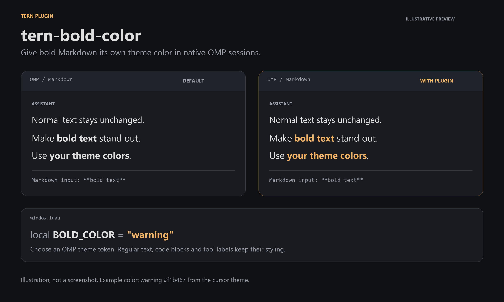

# Bold Color

Colors bold Markdown text in Tern's native OMP session, using a configurable OMP theme token. It does not recolor terminal ANSI output or tool labels, and does not patch OMP core.



*Illustrative before/after using the cursor's `warning` token; not a screenshot. The displayed color depends on the active theme, not a fixed universal value.*

## Install

Install Tern first; this plugin requires a native OMP session in Tern.

If `bold-color` is already linked, unlink it before installing; this preserves the source:

```sh
tern plugin unlink bold-color
```

Then install:

```sh
tern plugin install https://github.com/zettxh/tern-bold-color
```

## Customize

Find the installed plugin directory with:

```sh
tern plugin dir
```
Edit `window.luau` inside the installed `bold-color` directory. Set `BOLD_COLOR` to an OMP theme token such as `warning`, `accent`, or `borderAccent`:

```lua
local BOLD_COLOR = "warning"
```

Reload plugins:

```sh
tern plugin reload
```

The default uses the OMP theme's `warning` token, with Tern's warning color as fallback. This setting affects bold Markdown in the native OMP session only; ANSI colors are separate.
